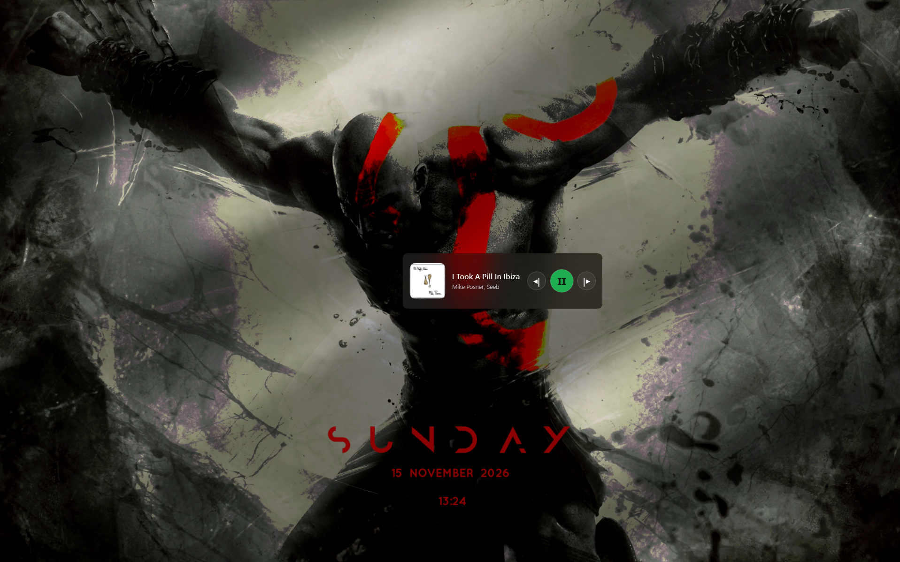
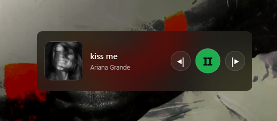
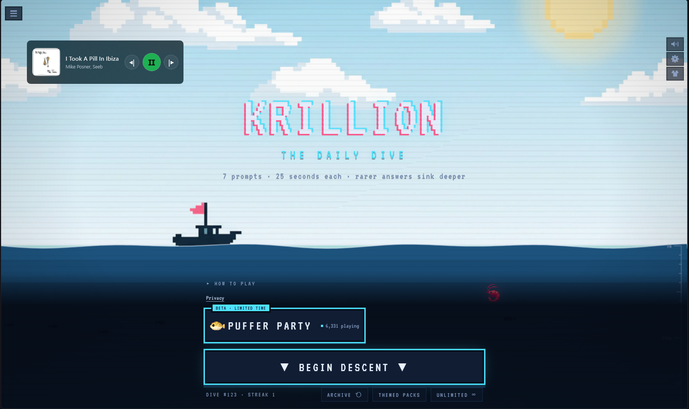

# Desk-Spot 🎵

A floating Spotify desktop widget built with Python and PyQt6, featuring a glassmorphism interface.

## Features

- Glassmorphism desktop interface
- Real-time Spotify playback monitoring
- Album artwork display
- Song title and artist information
- Play/Pause, Next and Previous controls
- Automatic widget visibility
- Windows Acrylic effects
- Automatic Windows startup support

## Tech Stack

- Python
- PyQt6
- Spotipy
- Spotify Web API
- Requests
- Windows API

## Installation

1. Clone the repository.

```bash
git clone https://github.com/AviralVerma17/Desk-Spot.git
cd Desk-Spot
```

2. Install dependencies.

```bash
python -m pip install -r requirements.txt
```

3. Create `credentials.py` using `credentials.example.py` as a reference.

4. Add your Spotify Developer credentials.

5. Run the application.

```bash
python main.py
```

## Requirements

- Windows
- Python 3.13 or compatible version
- Spotify account
- Spotify Developer application

## Note

This project uses the Spotify Web API and requires user authorization.

## License

No license has been specified yet.


## Screenshots


### Desktop Integration


### Main Widget


### Always-on-Top Functionality

